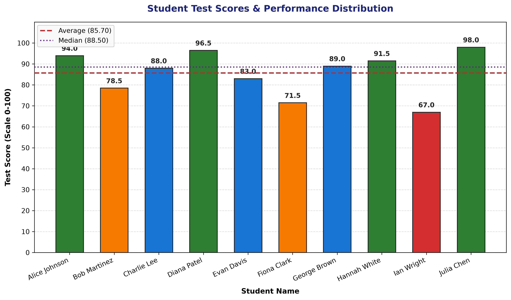

# AccuKnox AI Security Engineer Trainee Assessment

Engineering submission for the **AI Security Engineer Trainee** position at **AccuKnox**.

- **Candidate:** Nikhil Dehariya
- **Email:** [nikhildehariya100@gmail.com](mailto:nikhildehariya100@gmail.com) | **Phone:** +91 7024023209
- **GitHub:** [github.com/nikhildehariya](https://github.com/nikhildehariya) | **LinkedIn:** [linkedin.com/in/nikhildehariya](https://www.linkedin.com/in/nikhildehariya/)
- **Preprint & Benchmark:** [Zenodo DOI: 10.5281/zenodo.23623576](https://doi.org/10.5281/zenodo.23623576)
- **Primary Deliverable Report (PDF):** [Nikhil_Dehariya.pdf](Nikhil_Dehariya.pdf) *(Detailed 4-page report with architecture defense and evaluation matrices)*
- **Markdown Report:** [ASSIGNMENT_REPORT.md](ASSIGNMENT_REPORT.md)

---

## Repository Structure

```text
.
├── data/
│   └── sample_users.csv            # Source CSV with valid and malformed edge cases
├── outputs/
│   ├── student_scores.png          # High-DPI (300 DPI) performance distribution chart
│   └── chatbot_architecture.png    # Enterprise LLM chatbot architecture diagram
├── src/
│   ├── 1_books_api_sqlite.py       # REST API ingestion with deterministic fallback & SQLite
│   ├── 2_student_scores_viz.py     # Summary statistics calculation & high-DPI bar chart
│   └── 3_csv_to_sqlite.py          # RFC 5322 regex validation & parameterized SQLite ingestion
├── tests/
│   └── test_pipelines.py           # Pytest unit test suite covering all pipelines
├── ASSIGNMENT_REPORT.md            # Comprehensive technical report
├── Nikhil_Dehariya.pdf             # 4-page technical assessment report
├── requirements.txt                # Project dependencies
└── README.md
```

---

## Core Pipeline Implementations

### 1. REST API Data Retrieval & SQLite Storage (`src/1_books_api_sqlite.py`)
Fetches cybersecurity book records from the OpenLibrary REST API with a 4.0-second timeout. Includes an automated deterministic fallback mechanism against upstream API downtime or network isolation. Persists records into `data/books.db` using parameterized queries with a `UNIQUE(title, author)` constraint and `INSERT OR IGNORE` to eliminate SQL injection attack surfaces and duplicate entries. Formats stored records into an ASCII terminal table.

### 2. Data Processing & Visualization (`src/2_student_scores_viz.py`)
Processes student test score distributions and computes summary metrics (Mean: 85.70, Median: 88.50, Min: 67.00, Max: 98.00, Std Dev: 10.53). Exports a publication-quality 300 DPI visualization to `outputs/student_scores.png` with color-coded performance tiers and benchmark reference lines.



### 3. CSV Data Validation & SQLite Import (`src/3_csv_to_sqlite.py`)
Sanitizes `data/sample_users.csv` using strict RFC 5322-compliant regex email validation. Detects and logs invalid rows (missing fields, consecutive dots, malformed syntax), inserting valid users into `data/users.db` via parameterized SQL with a `UNIQUE(email)` constraint.

---

## Setup & Execution

### 1. Installation
```bash
git clone https://github.com/nikhildehariya/accuknox-ai-security-assignment.git
cd accuknox-ai-security-assignment

python -m venv venv
# Windows:
venv\Scripts\activate
# Linux/macOS:
source venv/bin/activate

pip install -r requirements.txt
```

### 2. Run Data Pipelines
```bash
# Task 1: Fetch books and store in data/books.db
python src/1_books_api_sqlite.py

# Task 2: Calculate score metrics and generate chart
python src/2_student_scores_viz.py

# Task 3: Validate CSV and store users in data/users.db
python src/3_csv_to_sqlite.py
```

### 3. Run Automated Tests
```bash
python -m pytest -v tests/test_pipelines.py
```

---

## Code References (Problem Statement 1 Q4 & Q5)

- **Most Complex Python Code Written (PS1 Q4):**  
  [`ProteoPredict/src/training/train_trimodal_multibranch.py`](https://github.com/nikhildehariya/ProteoPredict/blob/main/src/training/train_trimodal_multibranch.py)  
  *Context:* PyTorch tri-modal deep neural network fusing 1280-dim ESM-2 transformer embeddings, 3-mer TF-IDF sequence matrices, and continuous physicochemical descriptors across 17,624 biological targets under strict zero-leakage cross-validation (*BMC Bioinformatics*, Springer Nature; Zenodo DOI: [10.5281/zenodo.23623576](https://doi.org/10.5281/zenodo.23623576)).

- **Most Complex Database / Pipeline Code Written (PS1 Q5):**  
  Repository: [`https://github.com/nikhildehariya/netguard-ids/tree/main`](https://github.com/nikhildehariya/netguard-ids/tree/main)  
  Database Module: [`netguard-ids/src/detections_db.py`](https://github.com/nikhildehariya/netguard-ids/blob/main/src/detections_db.py)  
  *Context:* Real-time threat telemetry persistence engine for NetGuard IDS v2.2 ingesting IoT security alerts and MITRE ATT&CK vectors into PostgreSQL (Neon Cloud) and SQLite with 100% parameterized queries, thread-safe pooling, and composite indexing.

---

## Technical Report & Architecture Defense

Full details for **Assignment 2** and **Assignment 3** are documented in [Nikhil_Dehariya.pdf](Nikhil_Dehariya.pdf) and [ASSIGNMENT_REPORT.md](ASSIGNMENT_REPORT.md):
- **Candidate Self-Ratings (A/B/C):** LLM (A), Deep Learning (A), AI (A), ML (A) with project evidence.
- **Enterprise LLM Chatbot Architecture:** Pre-inference (adversarial prompt injection detection, PII/secret masking) and post-inference (grounding hallucination audit, secret leak prevention) guardrails with Qdrant vector retrieval.
- **Vector Database Selection Defense:** Comparative analysis of Qdrant vs. pgvector vs. Milvus for a real-time SOC threat-intel retrieval engine (payload-aware HNSW traversal, Rust memory predictability, sub-15ms P99 latency).
- **Proudest Project Showcase:** NetGuard IDS v2.2 ([github.com/nikhildehariya/netguard-ids](https://github.com/nikhildehariya/netguard-ids)) with a 3-line engineering difficulty breakdown.
